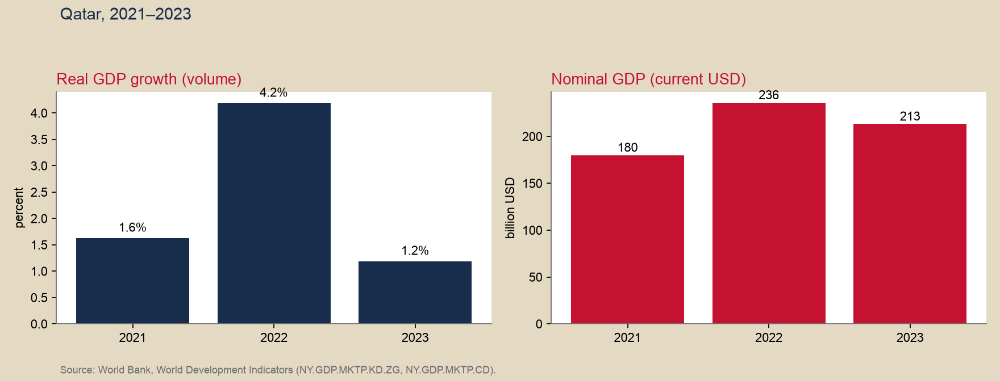
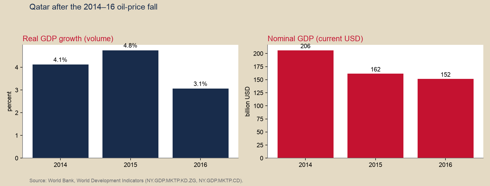
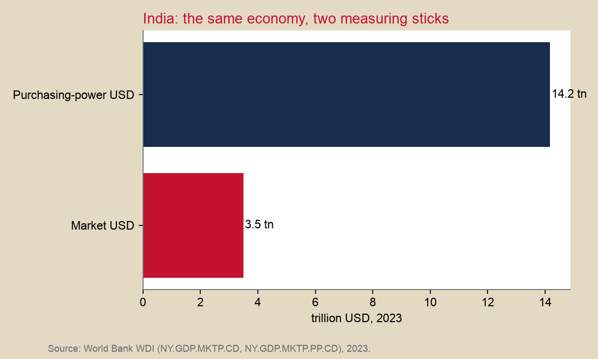
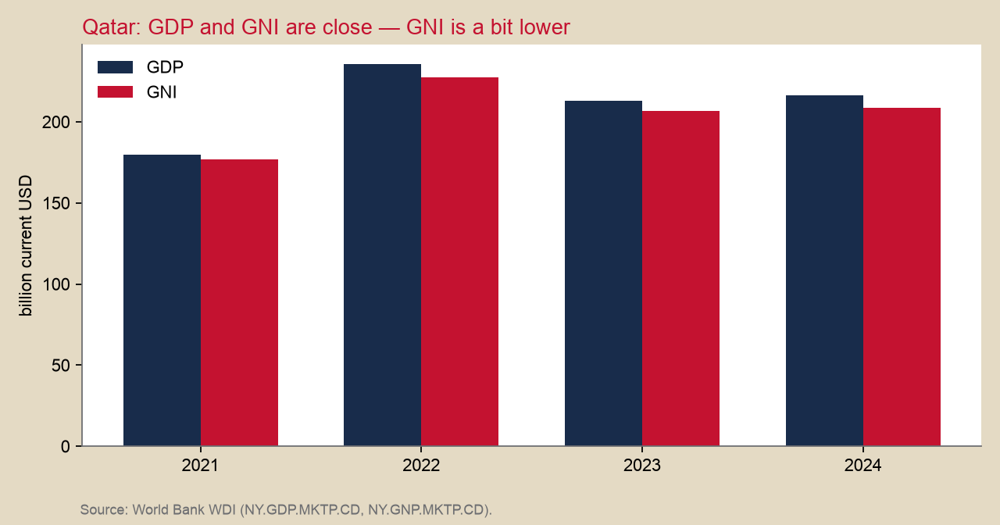

This page is the take-home for the GDP unit. It is **not** homework (submit nothing here). It is **not** Monday’s quiz.

Walk each beat: read the idea → try the problem → then open the reveal. The four moves are the ones used on exams: **concept**, **algebra**, **graph**, **case**.

Data on this page: **World Bank, World Development Indicators**, unless a sentence names the International Monetary Fund Country Report 24/43. CORE readings: *The Economy* 2.0 Macro 3.1–3.4.

Calendar: [Schedule](../schedule.qmd) · [Measurement notes](../notes/01-measurement.qmd)

---

## 1. Two stories about the same country

**Idea.** Qatar’s **dollar** GDP fell from 2022 to 2023 ($236 billion → $213 billion). **Volume** still grew (+4.2% then +1.2%). A manager who only reads the dollar number thinks 2023 was a contraction.

**Your try (graph).** In one sentence: which panel answers “did the economy produce more stuff?” Which panel answers “did the dollar value of that stuff rise?”

Reveal

Left panel = volume (real growth). Right panel = current dollars (nominal). 2023: more stuff, cheaper hydrocarbon prices, so the dollar total fell. World Bank: `NY.GDP.MKTP.KD.ZG`, `NY.GDP.MKTP.CD`.

---

## 2. The 2014–16 oil-price fall — predict, then look

**Your try.** The dollar price of oil collapsed. Did Qatar’s **dollar** GDP fall? Did **volume** fall as much? Write your guess before you open the figure.

Reveal — the chart

Nominal GDP $206 billion (2014) → $152 billion (2016). Real growth stayed **positive** each year. Same lesson as 2022–23, bigger crash. World Bank WDI.

---

## 3. Concept — is it in GDP?

**Your try.** For each, answer GDP or not, and which letter if yes (C, I, G, X−M). An import can be two letters.

1. 2019 Land Cruiser on Qatar Living.  
2. New iPhone at Vodafone (assembled abroad).  
3. QNB shares.  
4. Teacher’s salary, Ministry of Education.  
5. European fan’s Doha hotel, World Cup 2022.  
6. North Field East LNG train.  
7. New Qatar Airways aircraft (imported).  
8. A worker in Doha sends money home.  
9. Unsold new cars on a Doha dealer’s lot.

Reveal

1. Not GDP (used).  
2. C and −M.  
3. Not I (financial).  
4. G.  
5. X (service export).  
6. I.  
7. I and −M.  
8. Not C in Qatar; can move **GNI**, not GDP.  
9. +I (inventories). When they sell, −I and +C (or +X).

---

## 4. Algebra — value added

Cotton shirt (CORE 3.2). Fill the last column, then the totals.

| Stage | Cost of input | Price of output | Value added |
|-------|---------------|-----------------|-------------|
| Raw cotton | 0 | 50 | ? |
| Cloth | 50 | 80 | ? |
| Shirt | 80 | 100 | ? |
| Sum of **sales** | | | ? |
| Sum of **value added** = final sale | | | ? |

Reveal

Value added: 50, 30, 20. Sum of sales = 230 (wrong if you call that GDP). Sum of value added = 100 = the final shirt. Do not add intermediate invoices.

---

## 5. Algebra — karak and dates

Year 1: karak P=10, Q=100; dates P=20, Q=50.  
Year 2: karak P=12, Q=110; dates P=22, Q=55.

Compute nominal GDP in each year, and real GDP in year 2 using year-1 prices.

Reveal

Nominal Y1 = 10×100 + 20×50 = **2,000**.  
Nominal Y2 = 12×110 + 22×55 = **2,530**.  
Real Y2 (Y1 prices) = 10×110 + 20×55 = **2,200**.  
Nominal growth 26.5%. Real growth 10%. The gap is prices.  
Classroom illustration (Qatari riyals), not a national account. Same shape as CORE 3.4.

---

## 6. Three identities (write them once)

\[
Y_{\text{output}} = \sum \text{value added},\quad
Y_{\text{income}} = \text{wages}+\text{profit}+\text{rent}+\cdots,\quad
Y_{\exp} \equiv C+I+G+(X-M)
\]

If we counted everything, the three are equal. Recessions are falling output — therefore falling expenditure. Source: CORE 3.2–3.3.

**World Cup (IMF Country Report 24/43):** hotels and visitors in 2022 Q4 are a **flow** (X and C). Metro, port, Lusail over a decade are **I** (about US$200–300 billion of infrastructure; on the order of 1% of 2022 GDP for the event itself).

---

## 7. Graph — India, two measuring sticks

**Your try (graph).** Why can India look four times larger at purchasing-power than at market exchange rates? What would a phone-exporter care about that a local hairdresser would not?

Reveal

Haircuts and rent are cheap relative to tradable goods. Purchasing-power GDP prices a common basket. Market dollars matter when the invoice is in dollars (imported phones, factory equipment). World Bank WDI, 2023: market GDP $3.5 trillion; PPP $14.2 trillion.

---

## 8. Case (Type IV) — not Monday’s quiz

You advise a firm that **earns in US dollars** and is choosing **one** country to **produce** a labor-intensive good: **Qatar, India, Vietnam, or Kenya**.

World Bank, 2023 (current USD, trillions except per person):

| | Dollar GDP | Purchasing-power GDP | Dollar GDP per person |
|--|------------|----------------------|------------------------|
| Qatar | 0.21 | 0.34 | 80,200 |
| India | 3.50 | 14.17 | 2,430 |
| Vietnam | 0.43 | 1.51 | — |
| Kenya | 0.11 | 0.35 | — |

Recommend one country for **production cost**, and say why that same country might be a **poor place to sell** a dollar-priced luxury good.

There is **no unique answer**. You must use the difference between dollar GDP and purchasing-power GDP. Do **not** use Argentina, Indonesia, Mexico, or Poland here — those appeared on older quizzes.

Reveal — a reasonable argument, not the only one

A low price level (purchasing-power GDP high relative to dollar GDP) means a dollar buys a lot of local labor and rent — attractive for **production**. The same low dollar incomes make **local sales** of a $1,000 device small. India and Vietnam typically show a large PPP-versus-market gap; Qatar’s price level is high (energy incomes). Kenya is closer to the “produce there, don’t sell luxury there” pattern. Grade the **mechanism**, not the country name.

---

## 9. GDP versus GNI

GNI = GDP + net primary income from abroad. In this World Bank vintage they are **close**; GNI is a bit lower. Remittances and foreign-owned energy profits are why the two can part. We still teach the definition when the gap is small.

---

Homework 1 is on **Canvas**, due 9 September. Quiz 1 is **Monday 31 August, at the end of class**. This Studio does not replace either.
