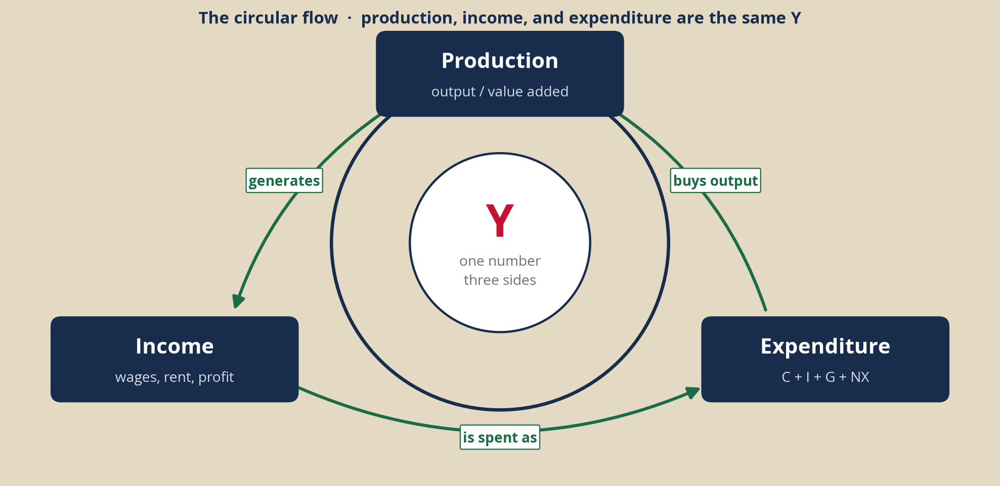
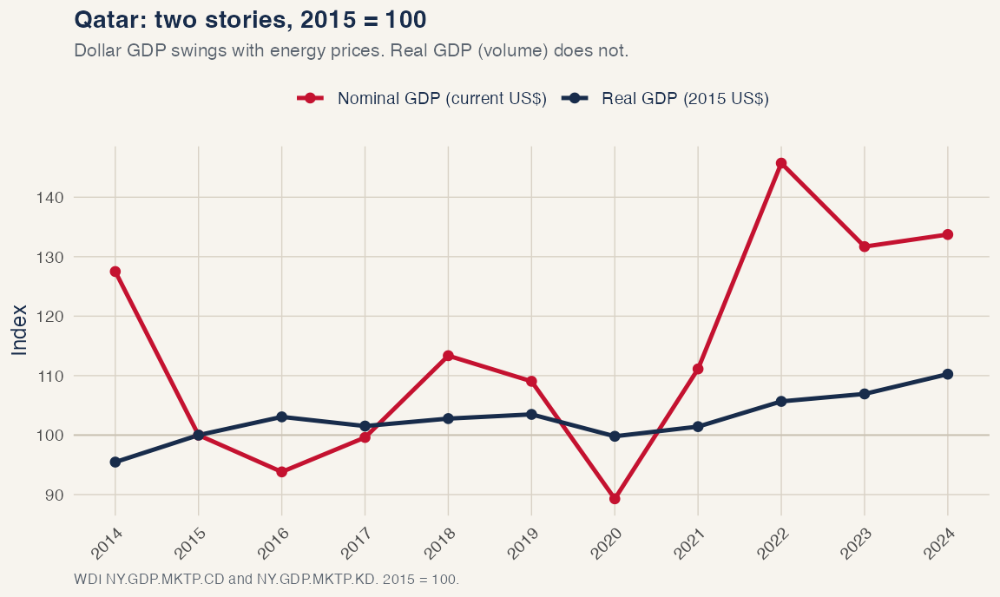
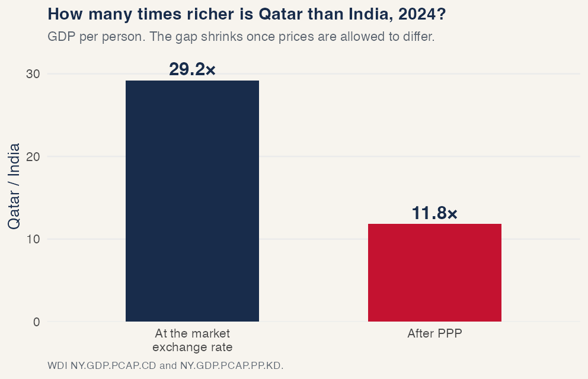
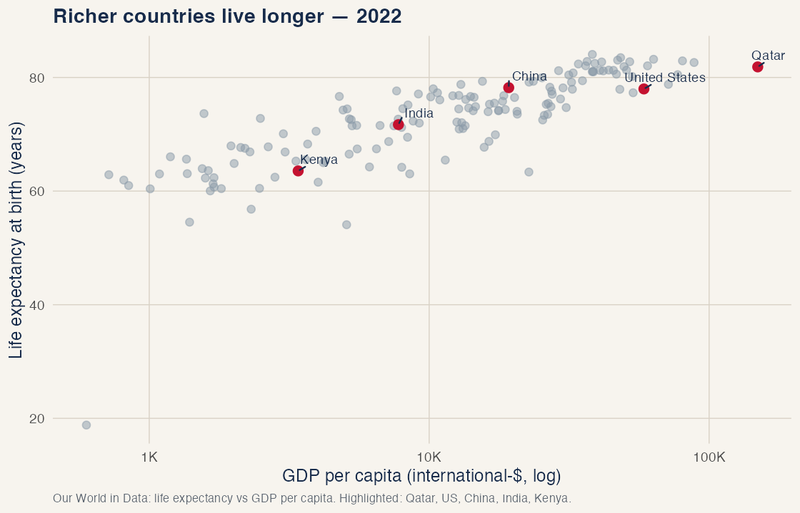
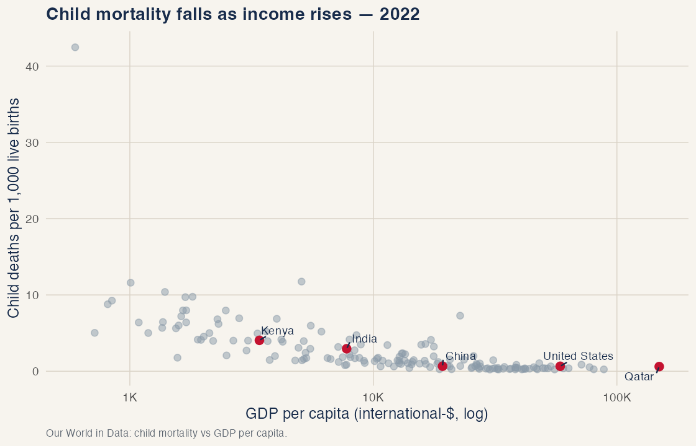
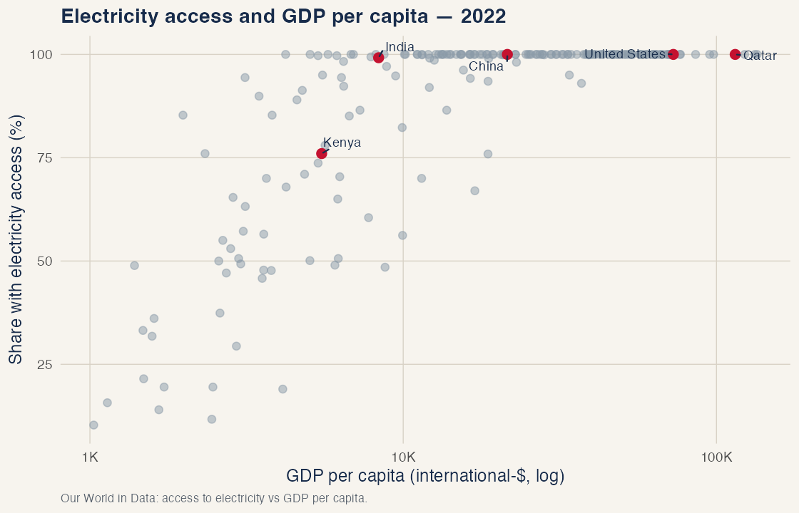

**Important note.** These notes complement the assigned chapters and the slides from class. They do not replace them.

---

# 1. Why measuring economic activity matters

Households, firms, and policymakers decide how much to produce, consume, and invest, and they set interest rates, using past data, current data, and forecasts of macroeconomic variables. One of those variables is GDP: the market value of all final goods and services produced within a country in a given period, typically a year.

Think of three agents in this region.

A **household** deciding whether to buy a dwelling in Lusail wants to know whether incomes on the territory are rising in *volume*, not only in the cash value of last year's cargo. A **firm** deciding whether to add a shift at Ras Laffan, or to open a second warehouse in Doha, wants the same distinction: more stuff, or the same stuff at a higher price. A **policymaker** at the Qatar Central Bank, or at the IMF when it writes an Article IV, needs a measure that can be compared across years and, with care, across countries.

GDP measures **production on the territory, in a period**. Happiness and household wealth are different objects. Like any statistic, the number has flaws. These notes cover how it is built, which version to use for which decision, and what to do when the books are thin.

---

# 2. Three ways to measure GDP

## One example, three counts

Consider a closed corner of Doha with two firms and no government.

**Al-Maha Dairy** sells milk to a karak stand for QR 30. It pays QR 18 in wages and keeps QR 12 as profit. It buys no intermediates.

**The karak stand** buys that milk (QR 30) and sells karak to households for QR 80. It pays QR 25 in wages and keeps QR 25 as profit.

**Check.** Write three numbers. Value added is sales minus intermediates.

1. Production: value added at the dairy plus value added at the stand.
2. Income: wages plus profits at both firms.
3. Expenditure: what households bought.

Do the three numbers match?

::: {.content-visible when-format="html"}

After you have three numbers

Production: dairy $30-0=30$, stand $80-30=50$, total $80$. Income: wages $18+25=43$, profits $12+25=37$, total $80$. Expenditure: households bought QR 80 of karak, so $C=80$. The three numbers match.

:::

They match because anything that is produced is sold (or added to inventories, which we treat as a sale to the firm itself). The riyal that pays for it is someone's income. So three stories add to the same total:

1. **Production** (value added): what each producer adds, after subtracting the intermediates it bought.
2. **Income**: wages, profits, and the other claims on that value added.
3. **Expenditure**: who bought the final goods and services: households, firms building capital, government, and the rest of the world.

Figure 1 is that loop. Production generates income; income is spent; spending buys the output. If one side of the loop is larger than another, we have miscounted.

{width=82%}

**Production**, written as a table. Value added is sales minus intermediates.

| Firm | Sales | Intermediates | Value added |
|------|------:|--------------:|------------:|
| Al-Maha Dairy | 30 | 0 | 30 |
| Karak stand | 80 | 30 | 50 |
| **GDP** | | | **80** |

If you add the invoices (30 + 80 = 110) you have counted the milk twice. GDP is the **50 the stand added** plus the **30 the dairy added**, not the sum of every bill.

**Income.** Wages $18+25=43$. Profits $12+25=37$. Income GDP $=43+37=80$.

**Expenditure.** Households bought QR 80 of karak. There is no investment, no government, no trade. Expenditure GDP $=C=80$.

The three approaches give the same number because they are an identity.

If the stand had also imported QR 8 of cups, its value added would fall to $80-30-8=42$, production GDP would be $30+42=72$, and expenditure would be $C=80$ minus $IM=8$, so $Y=72$. Imports are someone else's production.

## What statistical offices actually compile

Textbooks treat the three approaches as equals. Statistical offices do not.

GDP is, first, a **production** concept (System of National Accounts 2008; Eurostat's national-accounts manuals). Most statistical agencies start from industries: output minus intermediate consumption, plus taxes on products minus subsidies. Establishment surveys, VAT records, and industrial censuses exist even in middle-income countries. The United Nations' first milestone for implementing the SNA is GDP from the **production** and **expenditure** sides, by industry, not a full income account.

The **expenditure** side is what you will use in this course, because it names the agents: $C$, $I$, $G$, $NX$. It is also the side a firm can map onto a demand forecast. The weakness is the data. Household consumption surveys are slow. Inventories are noisy. Imports have to be stripped out of $C$, $I$, and $G$ so that foreign factories are not counted as ours.

The **income** side (compensation of employees, gross operating surplus, taxes on production) is often the residual. In many countries profits are whatever is left after production GDP is taken as given. That is useful for asking how the pie is split. It is a weak independent check.

The United States is the well-known exception: the Bureau of Economic Analysis builds the headline accounts from the **expenditure** side and reconciles production and income to it (Landefeld, Seskin, and Fraumeni 2008). The UK's ONS and most OECD compilers still treat production as the main series and expenditure as the demand decomposition (Lequiller and Blades, OECD).

When the three disagree, statistical offices record a **statistical discrepancy**. That gap is not a fourth kind of GDP. We will use expenditure for the rest of these notes, because that is how you will classify a transaction and how you will read a national-accounts release.

---

# 3. Measuring GDP with the expenditure approach

Expenditure GDP asks who bought the final goods and services produced on this territory in this period. Keep five cells: $\Delta C$, $\Delta I$, $\Delta G$, $\Delta NX$, $\Delta Y$. Zeros are allowed.

**Check.** For each line, fill the five cells. Do not write an identity yet. Just classify.

1. A used car sold by one resident of Doha to another.
2. An unemployment benefit (a transfer).
3. Household saving: money left in the bank, not spent on a new good.
4. A visitor from London pays QR 400 for dinner at Souq Waqif. Treat the meal as produced here.

::: {.content-visible when-format="html"}

After you have five cells for each

1. All zeros. A used car between two residents is not new production, so it is not $C$.
2. All zeros. A transfer is not $G$.
3. All zeros. Saving is not $I$.
4. $\Delta C=0$, $\Delta NX=+400$, $\Delta Y=+400$. A non-resident buying a service produced here is an export.

:::

Those cells have to add up. That is the expenditure identity:

$$
Y \equiv C + I + G + NX, \qquad NX = X - IM.
$$

| Symbol | What it is | Agent |
|--------|------------|--------|
| $C$ | Household consumption of **new** goods and services | Households |
| $I$ | Gross investment: plant, equipment, dwellings, and the change in inventories | Firms (and households, for new housing) |
| $G$ | Government **purchases** of goods and services, not transfers | Government as a buyer |
| $X$ | Foreign spending on goods and services produced here | Rest of the world |
| $IM$ | Spending, by anyone, on foreign output | Rest of the world (with a minus) |

$C$ is not "everything households do." Imports already sit inside $C$, $I$, and $G$ as they are recorded in the shops. Subtracting $IM$ stops us counting a Korean factory as Qatar's GDP. A useful habit: write a five-cell T-account $(\Delta C,\ \Delta I,\ \Delta G,\ \Delta NX,\ \Delta Y)$ and force

$$
\Delta C + \Delta I + \Delta G + \Delta NX = \Delta Y.
$$

Leave the zeros in. They tell you which components did not move.

## Four questions, easy to hard

Write the five cells. Then check the identity.

**(a)** A household in Al Khor buys QR 120 of dates grown and packed in Qatar this year. No imported inputs.

**(b)** A visitor from London pays QR 400 for dinner at Souq Waqif. Treat the meal as produced here.

**(c)** A Doha household buys an iPhone for QR 4,000. The import cost is QR 3,500. The local retailer's margin is QR 500.

**(d)** QatarEnergy installs modules on the North Field. The modules cost QR 800 and were built in Korea. Installation in Qatar costs QR 50. What happens to $I$, $NX$, and $Y$?

::: {.content-visible when-format="html"}

After you have five numbers for each

(a) $\Delta C=+120$, $\Delta Y=+120$.

(b) $\Delta C=0$, $\Delta NX=+400$, $\Delta Y=+400$. A non-resident buying a service produced here is an export.

(c) $\Delta C=+4{,}000$, $\Delta NX=-3{,}500$, $\Delta Y=+500$. Check: $4{,}000-3{,}500=500$. A tourist buying the same phone would be $X$ of the retail service, not $C$.

(d) $\Delta I=+850$, $\Delta NX=-800$, $\Delta Y=+50$. The Korean factory is Korea's GDP. Only installation is produced here.

:::

GDP on this territory is the **domestic value added**, not the sticker price and not the nationality of the shareholder. Ownership of QatarEnergy does not move the border.

---

# 4. Different ways to compute GDP, and when to use them

## A problem first

You are the credit officer at a Gulf bank. Head office sent two slides on Qatar.

Slide A: **dollar GDP** went from about **\$180 billion in 2021 to \$236 billion in 2022, then back to \$213 billion in 2023**. A colleague wants to cut the corporate book: "the economy shrank."

Slide B: **real GDP** (volume) **rose** through the same window.

Separately, the bank is choosing where to put a back-office that will pay local wages. One option is Doha. The other is a large South Asian city. Market-dollar GDP per person makes Qatar look roughly **thirty times** richer than India. The facilities team says that cannot be what a local salary actually buys.

**Check.** Write one line for each. Use the names nominal, real, or PPP.

1. Did Qatar's economy shrink in 2022–23? Which slide, and which measure?
2. What a local wage will buy in Doha vs Mumbai: which measure?
3. How many dollars the bank must send this quarter to pay a contractor at the desk: which measure?

::: {.content-visible when-format="html"}

After you have a line for each

1. Slide B, real GDP. Slide A is a dollar total that moved with LNG prices.
2. PPP.
3. The market rate (nominal dollars this quarter).

:::

You cannot answer with one number. You need three, and you need to know which question each one answers. We will keep this credit-committee problem as the running case.

## Nominal GDP

Nominal GDP values current production at **current prices**:

$$
\text{Nominal GDP}_t = \sum_i P_{i,t}\, Q_{i,t}.
$$

If either prices or quantities rise, the product can rise. Qatar's dollar GDP in 2022 is a price story as much as a quantity story: LNG prices moved. A minister who quotes only the dollar total is mixing a price shock into a quantity story.

## Real GDP

Real GDP holds prices at a **base year** $b$ and lets only quantities change:

$$
\text{Real GDP}_t = \sum_i P_{i,b}\, Q_{i,t}.
$$

The GDP deflator is the ratio of the two:

$$
\text{GDP deflator}_t = \frac{\text{Nominal GDP}_t}{\text{Real GDP}_t}\times 100,
\qquad
\pi_t = \frac{\text{deflator}_t - \text{deflator}_{t-1}}{\text{deflator}_{t-1}}.
$$

In the base year the deflator is 100 by construction.

Apply this to the bank. Between 2021 and 2023, Qatar's **nominal** GDP in dollars swung with energy prices. **Real** GDP, the volume of production, did not. The colleague who wants to cut the book on the basis of Slide A is reading a price. Hiring, capacity, and whether the economy produced more stuff are Slide B.

{width=88%}

The same mechanism showed up in 2014–16, when dollar GDP fell while real growth stayed positive. If nominal GDP rose, it could be $Q\uparrow$ with $P$ still, $P\uparrow$ with $Q$ still, both, or $P\uparrow$ faster than $Q\downarrow$. Qatar 2022–23 is the case the list often omits: **$Q$ up, $P$ down** in dollar terms.

## PPP-adjusted GDP

A riyal buys a different basket in Doha than the same dollar, converted at the market rate, buys in Mumbai. Purchasing-power parity converts with the **price of a comparable basket**, not with the FX desk.

$$
\text{PPP GDP} = \frac{\text{Nominal GDP in local currency}}{\text{PPP price level relative to the reference country}}.
$$

Equivalently, if a basket that costs $\$100$ in the US costs $150$ units of local currency, the PPP rate is $1.5$ local units per dollar, which need not equal the market rate.

In 2024, GDP per person at **market dollars** was about **\$76,000** in Qatar and **\$2,600** in India, so Qatar looks about **29 times** richer. At **PPP**, about **\$111,000** versus **\$9,400**, closer to **12 times**. India is not as poor, and Qatar is not as far ahead, once you let prices differ.

{width=78%}

For the back-office: if the question is **what a local wage will buy in the city where staff live**, use PPP. If the question is **how many dollars the bank must send this quarter to pay a contractor at the desk**, use the market rate. Those are different questions.

## When to use which number

CORE is right: you do not have "the" GDP. You have a family of numbers, and the business question picks which member to use.

The table below is the credit-committee version of that advice. Read it as a recommendation for which number to pull, given the question.

| Measure | Use it when the question is… | In the bank example |
|---------|------------------------------|---------------------|
| **Nominal GDP** | Cash this year: invoices, tax, the dollar value of a cargo | The 2022 LNG price spike. Do not hire on this number alone. |
| **Real GDP** | Whether the economy produced **more stuff** over time; hiring; capacity | Slide B. Volume rose while dollar GDP fell. That is the cycle you underwrite. |
| **PPP GDP (and PPP per person)** | Living standards and **local costs** across countries | The back-office. What a salary buys in Doha vs Mumbai, not the FX print. |

Nominal GDP is the right input for anything that is actually paid in current riyals or dollars. Real GDP is the right input for "did activity rise." PPP is the right input for "where does a unit of income go further." Mixing them is how Slide A and the facilities team talk past each other.

---

# 5. How to measure GDP when information is not available

**Check.** A firm is deciding whether to expand in a market whose **official** growth looks strong and whose **lights** at night are flat. Night lights are not in the national accounts.

Write two sentences.

1. Are the lights GDP?
2. Give one reason the two series can disagree.

::: {.content-visible when-format="html"}

After you have two sentences

Lights are a proxy for GDP, not GDP itself. They can disagree because of saturation in rich, dense cities; gas flares; a shift into services and software that do not show up as light; a war that knocks out the grid; or because the books are the object you do not trust.

:::

Yao (2019), in the IMF's *Finance & Development* (the short piece assigned for Discussion 1), puts the problem in one picture: when statistical agencies are thin, or the books are hard to trust, the Earth still lights up at night. The question is when the proxy is informative, and when it misleads.

## How the literature does it

Satellites in the Defense Meteorological Satellite Program (DMSP, roughly 1992–2013) and then VIIRS / NASA Black Marble (from 2012) record the intensity of lights. Economists **sum the lights over a country and a year** and compare that sum to official real GDP.

Henderson, Storeygard, and Weil (2012) write the measurement-error model. Lights growth is a noisy signal of true income growth; national accounts are another noisy signal; the two errors are assumed uncorrelated. For countries with weak statistical offices, the optimal estimate of growth puts substantial weight on lights. Their best-fit elasticity of measured **GDP growth with respect to lights growth** is about **0.3**:

$$
\widehat{g}_{Y} \approx 0.3 \times \% \Delta L.
$$

Hu and Yao (2022) estimate the other slope, the elasticity of **lights with respect to true GDP**, at about **1.3**:

$$
\% \Delta L \approx 1.3 \times g_{Y}^{\text{true}}
\qquad\Rightarrow\qquad
g_{Y}^{\text{true}} \approx \frac{\% \Delta L}{1.3}.
$$

They then form a composite

$$
g_{Y}^{\ast} = \rho\, g_{Y}^{\text{NA}} + (1-\rho)\, g_{Y}^{L},
$$

where $g_{Y}^{\text{NA}}$ is national-accounts growth, $g_{Y}^{L}$ is lights-implied growth, and $\rho$ is smaller when the statistical office is weaker. In their estimates the weight on lights ranges from $0.14$ to $0.88$, with a mean around $0.65$.

Lights mislead when the relationship between activity and bulbs is not stable: **saturation** in rich, dense cities; **gas flares**; a shift into services and software that do not show up as light; a war that knocks out the grid. Yao's Japan / Syria contrast is that point in one page.

## An application: China, 1993–2013

Qatar is the wrong country if the question is "the books are thin." The statistical office here is not weak. The paper behind the assigned F&D article is a better laboratory.

Hu and Yao (2022) take China over 1993–2013. Official real GDP growth in the national accounts sits well above the path implied by lights. Their composite says China's **true** average annual growth in that window was on the order of **3.6 percentage points below** the official figure. India in the same paper also comes in below the books. For conflict-torn African countries, they find that lights-based growth is **smoother** than the official series: the books jump around more than the lights.

That is the method in a country you already see in the news. Lights are not "the truth." The claim is narrower: when the incentive to report a round number is strong and the statistical system is not independent, a second measure that the ministry does not control is worth putting on the same slide as the communiqué. Martinez (2022) makes the political-economy version of the same point: for a given increase in lights, more autocratic regimes report **higher** GDP growth, on the order of a factor $1.15$–$1.3$ in the most authoritarian cases.

Ask *why* the official series and the lights disagree: flares, saturation, a statistical office, or a real boom the satellite is missing. Then pick a weight. That weight is $\rho$ in the equation above.

## Three other uses of satellite data in economics

Lights are one sensor. Economists have used others. Three papers show the range.

**Poverty maps from daytime imagery.** Jean, Burke, Xie, Davis, Lobell, and Ermon (2016, *Science*) train a model on daytime satellite images (roofs, roads, farmland) to predict village-level poverty in several African countries, in places where a household survey has not been in the field for years. The model **fills the years and the districts the survey missed**, cheaply enough that a ministry or an NGO can use it.

**Cities, transport costs, and lights.** Storeygard (2016, *Review of Economic Studies*) uses night lights as a measure of **urban economic activity** in sub-Saharan African cities, and oil prices as a shock to the cost of road transport. When oil is expensive, cities that are farther from the port grow more slowly in the lights. The paper is a test of a classical urban model in a setting where city GDP does not exist as an official series.

**Who gets the public goods.** Hodler and Raschky (2014, *Quarterly Journal of Economics*) look at night lights around the **birthplaces of political leaders**. Regions that produce the president light up relative to the rest of the country. That is a measure of regional favoritism that does not pass through the budget tables the ministry publishes.

Donaldson and Storeygard (2016, *Journal of Economic Perspectives*) survey the wider set: crop yields, deforestation, pollution, fishing. The common idea is the same as Yao's. When the variable you care about is not in the books, or the books are the object you do not trust, look at a sensor the agent you are studying does not control.

---

# 6. What GDP does not capture, and what it still tracks

**Check.** A meal cooked at home is production. A meal at Souq Waqif is production.

1. Which meal is in GDP?
2. Look at the three figures below. Each dot is a country. Qatar, the United States, China, India, and Kenya are marked. What do the scatters **not** show? Write one thing GDP leaves out.

The three figures use the 2022 cross-section of countries (Our World in Data).

{width=88%}

{width=88%}

{width=88%}

::: {.content-visible when-format="html"}

After you have written both

1. Only the meal at Souq Waqif. Home production is out of GDP.
2. Any of: unpaid work, the informal sector, leisure, environment and depletion, inequality, quality and new goods, zero-price digital services. The scatters show that GDP per person moves with material living standards. They do not show that GDP is well-being.

:::

GDP counts **market** production of **final** goods and services on the **territory** in a **period**. Drop a word and you are counting something else. That design leaves a list of omissions that CORE 3.5 walks through, and that the two assigned articles extend.

- **Home production and unpaid work.** A meal cooked at home is production. It is not in GDP. A meal at Souq Waqif is. Cross-country comparisons of "how much is produced" are tilted toward economies where more activity passes through a market.
- **The informal sector.** Street vendors, cash construction, unregistered workshops. Some countries try to impute them. Many undercount. A rebasing year in which the imputation is updated can look like a growth miracle (Nigeria 2014 is the usual exhibit).
- **Leisure.** GDP does not rise when people work fewer hours and enjoy the evening. It can rise when they work more and are more tired.
- **Environment and depletion.** Extracting gas raises $Y$. The loss of the reserve and the carbon are not subtracted. Qatar's accounts are not a sustainability statement.
- **Inequality.** A rise in $Y$ that accrues to the top tail is still a rise in $Y$. GDP per person is an average.
- **Quality and new goods.** A smartphone that is twice as capable at the same price is a real increase in consumption. Price indices are slow to catch it.
- **Zero-price digital services.** Google Maps, WhatsApp, open-source software. Wladawsky-Berger (2019) is the assigned WSJ piece: if the price is zero, expenditure GDP records zero, even if the service is valuable. GDP-B and related proposals try to put a number on that missing consumer surplus. They are not in the official accounts.

GDP is still a useful readout of **material living standards**. It is an imperfect measure of quality of life, but it is **highly correlated** with many of the outcomes people actually care about. If you cannot observe life expectancy, child survival, or the grid in every district, GDP per person is a noisy but close proxy for the cluster of outcomes that move with income. That is why the course starts with GDP, and then asks what the number leaves out.

---

# References

Bureau of Economic Analysis. *NIPA Handbook: Concepts and Methods of the U.S. National Income and Product Accounts*. U.S. Department of Commerce.

CORE Econ. 2023. *The Economy 2.0: Macroeconomics*, Units 3 and 4. https://books.core-econ.org/

Donaldson, Dave, and Adam Storeygard. 2016. "The View from Above: Applications of Satellite Data in Economics." *Journal of Economic Perspectives* 30 (4): 171–198.

Eurostat. *Building the System of National Accounts — Basic Concepts*. European Commission.

Henderson, J. Vernon, Adam Storeygard, and David N. Weil. 2012. "Measuring Economic Growth from Outer Space." *American Economic Review* 102 (2): 994–1028.

Hodler, Roland, and Paul A. Raschky. 2014. "Regional Favoritism." *Quarterly Journal of Economics* 129 (2): 995–1033.

Hu, Yingyao, and Jiaxiong Yao. 2022. "Illuminating Economic Growth." *Journal of Econometrics* 228 (2): 359–378.

Jean, Neal, Marshall Burke, Michael Xie, W. Matthew Davis, David B. Lobell, and Stefano Ermon. 2016. "Combining Satellite Imagery and Machine Learning to Predict Poverty." *Science* 353 (6301): 790–794.

Landefeld, J. Steven, Eugene P. Seskin, and Barbara M. Fraumeni. 2008. "Taking the Pulse of the Economy: Measuring GDP." *Journal of Economic Perspectives* 22 (2): 193–216.

Lequiller, François, and Derek Blades. *Understanding National Accounts*. OECD Publishing.

Martinez, Luis R. 2022. "How Much Should We Trust the Dictator's GDP Growth Estimates?" *Journal of Political Economy* 130 (10): 2731–2769.

Storeygard, Adam. 2016. "Farther on down the Road: Transport Costs, Trade and Urban Growth in Sub-Saharan Africa." *Review of Economic Studies* 83 (3): 1263–1295.

United Nations, European Commission, IMF, OECD, and World Bank. 2008. *System of National Accounts 2008*.

Wladawsky-Berger, Irving. 2019. "When GDP Won't Do: A New Method For Measuring Digital's Value." *Wall Street Journal*, 24 May.

World Bank. World Development Indicators; Space2Stats Black Marble nighttime lights.

Yao, Jiaxiong. 2019. "Illuminating Economic Growth." *Finance & Development* (IMF), September.
